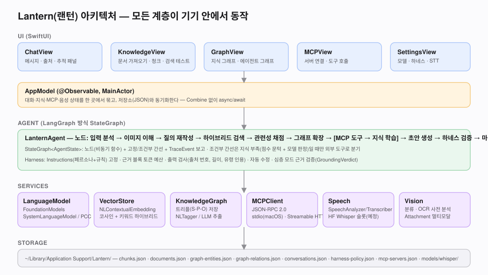
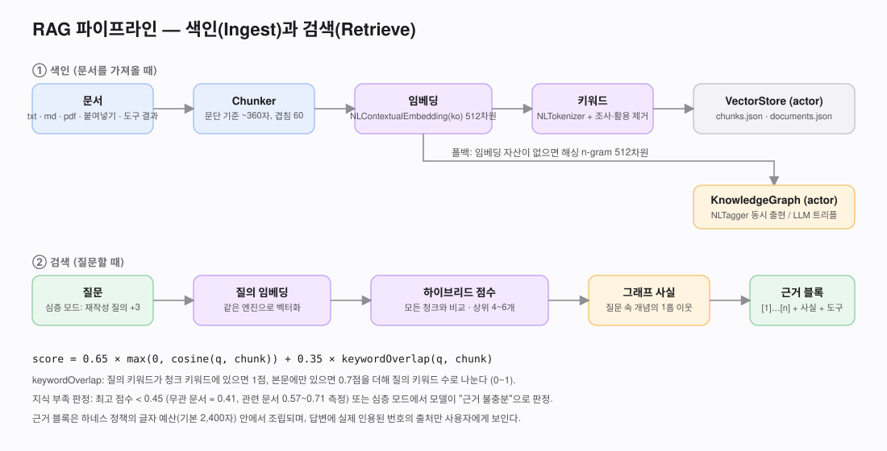
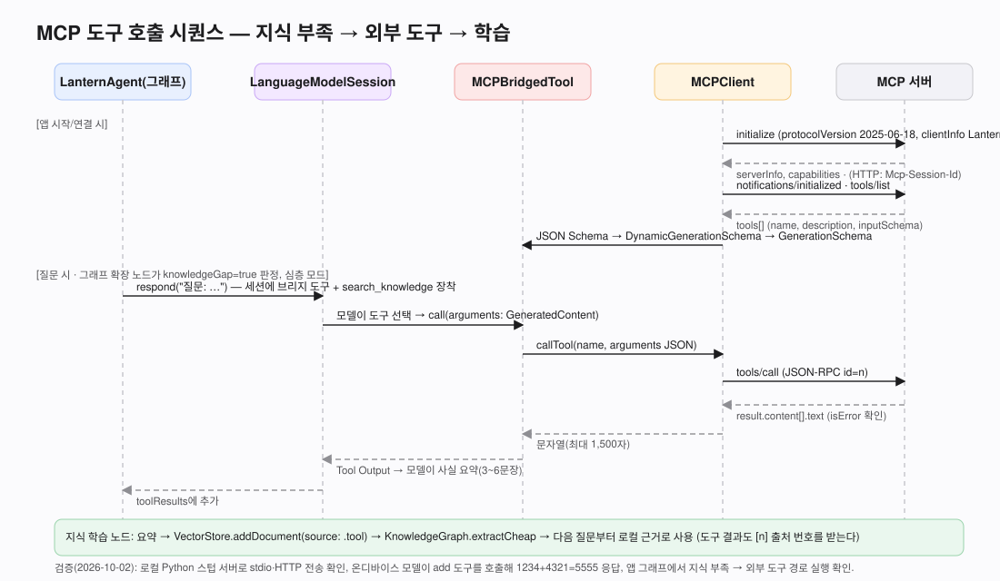

# Lantern(랜턴) — 기술 PRD

| 항목 | 내용 |
|---|---|
| 문서 버전 | 1.0 (2026-10-02) |
| 제품 | Lantern(랜턴) — 온디바이스 RAG 에이전트 |
| 플랫폼 | macOS 27 (1차), iOS/iPadOS 27, visionOS 27 (빌드 확인) |
| 언어/프레임워크 | Swift 5 모드, SwiftUI, FoundationModels, NaturalLanguage, Vision, Speech, PDFKit |
| 라이선스 | Apache-2.0 |

## 0. 이름

**Lantern(랜턴)**. 어두운 곳을 비추는 등불처럼, 기기 안에 들고 다니는 내 지식이 질문하는 순간 켜진다는 뜻이다. 온디바이스·프라이버시(불빛이 밖으로 새지 않음)와 RAG의 "찾아서 비춤" 은유를 함께 담았다. 초기 이름 '온지(Onji, 온고지신)'는 2026-10-02 사용자 요청으로 미국식 이름 Lantern으로 바꿨다. UI 표시 이름은 "Lantern", 한국어 문장 안에서는 "랜턴"으로 쓴다.

## 1. 배경과 목표

사용자는 "나만의" 지식을 다루는 에이전트를 원하지만, 문서와 대화가 외부 서버로 나가는 것은 원치 않는다. Apple 플랫폼 27은 온디바이스 언어 모델(FoundationModels), 온디바이스 문장 임베딩(NLContextualEmbedding), 온디바이스 음성 인식(SpeechAnalyzer), 멀티모달 Attachment를 모두 제공하므로, 외부 API 없이 완결되는 RAG 에이전트를 만들 수 있다.

### 목표

1. 질문 → 로컬 지식 검색 → 근거 기반 답변 → 출처 표기까지 기기 안에서 끝낸다.
2. 작은 모델(SLM)의 한계를 RAG, 지식 그래프, 하네스로 보완해 일관된 답변을 낸다.
3. 지식이 부족하면 MCP 도구로 가져오고, 가져온 사실을 다시 지식으로 저장한다(학습 루프).
4. 에이전트의 모든 결정이 보이도록 그래프 실행 추적을 UI에 그린다.

### 비목표 (v1)

- 클라우드 LLM(OpenAI, Anthropic 등) 연동. Apple Private Cloud Compute만 선택지로 둔다.
- 수천 문서 규모의 벡터 DB. v1은 JSON 파일 + 메모리 내 코사인 검색(수백~수천 청크)까지만 목표로 한다.
- 모델 파인튜닝.

## 2. 사용자 요구사항과 설계 결정

사용자가 요청한 항목과, 검토 후 조정한 내용이다.

| 요청 | 결정 | 이유 |
|---|---|---|
| 가벼운 SLM = Apple Foundation Model | `SystemLanguageModel.default` 사용 | 온디바이스, 약 3B 매개변수, 가이드 생성(@Generable)과 도구 호출 지원 |
| 심층 검색 모드 | 빠른/심층 두 모드 | 심층은 질의 재작성·채점·그래프·MCP·근거 검증까지 수행(약 15초), 빠른은 검색 1회(약 9초) |
| RAG로 부족한 지식 보강 | 하이브리드 검색 + 지식 부족 판정 + MCP 도구 + 학습 노드 | 임베딩 점수 문턱(0.45)과 모델 판정(GapAssessment)을 합쳐 오탐을 줄임 |
| "랭그래프로 지식 관리" | LangGraph 방식 StateGraph(에이전트 흐름) + 지식 그래프(트리플 저장) 두 가지로 해석해 둘 다 구현 | LangGraph 자체는 Python 라이브러리라 Swift에 없음. 동일 개념(상태·노드·조건부 간선)을 Swift로 재구현 |
| MCP 지원 | JSON-RPC 2.0 클라이언트, stdio(macOS) + Streamable HTTP | 도구 스키마를 DynamicGenerationSchema로 변환해 모델이 직접 호출 |
| 하네스로 일관성 | HarnessPolicy(Instructions 고정) + 출력 검사 + 자동 수정 + 근거 검증 | 모델 밖에서 규칙을 강제해야 작은 모델도 일관됨 |
| 멀티모달 VLM | 별도 VLM 없이 FoundationModels `Attachment(image)` 사용 (OS 27) | 온디바이스 모델이 이미지를 직접 봄. Vision 분류·OCR을 보조 근거로 추가 |
| STT | Apple SpeechAnalyzer/SpeechTranscriber를 기본 적용. Hugging Face Whisper는 "탑재 예정" 슬롯 | Apple이 온디바이스 STT 모델을 제공하므로 바로 적용. 요청대로 HF 모델 로딩 자리를 코드로 마련 |

### 사용자 요청에서 바로잡은 점

- **STT 모델 없음 가정** → Apple Speech 프레임워크가 온디바이스 모델을 제공하므로 기본으로 쓴다. Hugging Face 슬롯은 선택 사항이다.
- **VLM 별도 필요** → OS 27의 FoundationModels는 이미지 Attachment를 지원하므로 별도 VLM이 필요 없다.
- **LangGraph** → Swift 네이티브 StateGraph 엔진으로 동일 개념을 구현했다.

### 사용자가 빠뜨린 것 중 추가한 것

- 대화 기억(세션 저장·복원), `remember` 도구(장기 기억을 지식 저장소에 저장)
- 컨텍스트 윈도 관리(요청마다 새 세션 + 최근 4턴 요약 주입, 근거 글자 예산)
- 출처(인용) 검증(없는 번호 인용 탐지), 에러 번역(컨텍스트 초과·거부·언어 미지원)
- 그래프 실행 추적 UI, 지식 검색 테스트 UI, MCP 도구 수동 호출 UI
- Private Cloud Compute 백엔드 옵션(엔타이틀먼트 필요, 기본 꺼짐)

## 3. 아키텍처

| 계층 | 구성 | 파일 |
|---|---|---|
| UI | ChatView, KnowledgeView, GraphView, MCPView, SettingsView, ContentView(NavigationSplitView) | `MyApp/App/*.swift`, `MyApp/ContentView.swift` |
| 상태 | AppModel(@Observable, MainActor) | `MyApp/App/AppModel.swift` |
| 에이전트 | StateGraph 엔진, LanternAgent(노드·간선), Harness | `Core/StateGraph.swift`, `Core/LanternAgent.swift`, `Core/Harness.swift` |
| 서비스 | LanguageModelService, VectorStore, KnowledgeGraph, MCPClient, MCPToolBridge, BuiltInTools, SpeechService, ImageUnderstanding, EmbeddingService | `Core/*.swift` |
| 저장 | Persistence(JSON) | `Core/Persistence.swift` |

### 동시성 모델

- 기본 액터 격리 = MainActor(프로젝트 설정). 뷰·AppModel·에이전트는 MainActor.
- 무거운 저장소는 `actor`(VectorStore, KnowledgeGraph, MCPClient).
- 순수 데이터 타입과 전송 계층은 `nonisolated`로 선언해 어느 액터에서나 쓴다.
- Combine 없음. 모든 비동기 흐름은 async/await와 AsyncStream.

## 4. 기능 명세

### 4.1 에이전트 그래프

| 노드 | 빠른 모드 | 심층 모드 | 구현 |
|---|---|---|---|
| 입력 분석 | 언어 감지, 질의 초기화 | 동일 | 한글 포함 여부 |
| 이미지 이해 | 첨부 있을 때 Vision 분류+OCR | 동일 | `ClassifyImageRequest`, `RecognizeTextRequest` |
| 질의 재작성 | 건너뜀 | `QueryRewrite` 3개 생성 | @Generable |
| 하이브리드 검색 | 상위 4 | 질의마다 상위 6, 병합 | VectorStore.search |
| 관련성 채점 | 건너뜀 | 상위 5개 `RelevanceGrade` | @Generable |
| 그래프 확장 | 1홉 사실 + 점수 문턱 | + `GapAssessment` 모델 판정 | KnowledgeGraph.facts |
| 외부 도구(MCP) | 없음 | 지식 부족 && MCP 도구 있음 → 조사 세션 | MCPBridgedTool + KnowledgeSearchTool |
| 지식 학습 | 없음 | 도구 요약을 문서로 저장, 그래프 갱신 | VectorStore.addDocument(.tool) |
| 초안 생성 | 스트리밍 | 동일(이미지 있으면 Attachment) | Harness.answerPrompt |
| 하네스 검증 | 규칙 검사 → 1회 수정 | + `GroundingVerdict` → 1회 수정 | Harness.check |
| 마무리 | 인용된 출처만 첨부 | 동일 | 정규식 `[n]` |

### 4.2 RAG

- 청킹: 문단 기준 약 360자, 긴 문단은 60자 겹침.
- 임베딩: `NLContextualEmbedding(language: .korean)`(ja/ko/zh 공용 모델, 512차원) 서브워드 평균 풀링 → 정규화. 자산 없으면 해싱 n-gram 512차원 폴백. 엔진이 바뀌면 전체 재색인.
- 점수: `0.65 × cosine + 0.35 × keywordOverlap`.
- 가져오기: txt/md/text(UTF-8/UTF-16), PDF(PDFKit), 붙여넣기, MCP 도구 결과, remember 도구.

### 4.3 지식 그래프

- 저장: `GraphEntity(id, name, kind, mentions)`, `GraphRelation(subject, predicate, object, sourceChunkID, weight)`.
- 저렴한 추출: NLTagger 고유명사 + 빈출 키워드 동시 출현("함께 언급"). 문서 가져올 때 자동.
- 정확한 추출: `ExtractedTriples` @Generable(청크당 최대 6개). 사용자가 지식 저장소에서 실행.
- 질의: 질문에 등장한 엔티티의 1홉 이웃을 문장으로 근거 블록에 추가.
- UI: 원형 배치 Canvas, 엔티티 선택 시 이웃 관계와 출처 청크 표시.

### 4.4 MCP

- 프로토콜: JSON-RPC 2.0, `initialize` → `notifications/initialized` → `tools/list` → `tools/call`.
- 전송: stdio(Process + 줄 단위 JSON, macOS 전용, DYLD_* 환경 변수 제거), Streamable HTTP(POST, JSON 또는 SSE 응답, Mcp-Session-Id 유지, DELETE로 종료).
- 브리지: JSON Schema(object/string/integer/number/boolean/array/enum, required) → `DynamicGenerationSchema` → `GenerationSchema`. 도구 이름은 영숫자/밑줄로 정규화. 모델 컨텍스트 보호를 위해 세션당 최대 5개.
- 검증: Python 스텁 서버(stdio·HTTP)로 왕복 확인, 모델이 `add` 도구를 호출해 1234+4321=5555 응답.

### 4.5 하네스

- `HarnessPolicy`: 페르소나, 규칙 목록, 출처 강제 여부, 근거 글자 예산(기본 2,400), 최대 문장 수(기본 8). 설정 화면에서 편집, JSON으로 저장.
- 검사: 빈 답변, 출처 번호 누락(모른다고 말한 경우 제외), 존재하지 않는 번호 인용, 과도한 길이.
- 수정: 같은 근거로 재작성 요청(최대 1회) + 심층 모드 근거 검증 실패 시 추가 1회.
- 세션 전략: 요청마다 새 세션. 최근 4턴을 200자씩 프롬프트에 주입해 문맥 유지, 컨텍스트 초과를 구조적으로 회피.

### 4.6 멀티모달과 음성

- 이미지: `fileImporter`로 첨부 → `Attachment(cgImage).label("image-n")`로 모델에 전달. macOS에선 Vision `OCRTool`을 세션 도구로 추가. 사전 분석(분류·OCR)은 모든 플랫폼에서 근거에 포함.
- 음성: `SpeechTranscriber(locale:preset: .progressiveTranscription)` + `SpeechAnalyzer`, AVAudioEngine 입력 탭 → `AnalyzerInputConverter`. 자산은 `AssetInventory`로 첫 사용 시 다운로드. 부분 결과는 미리보기, 종료 시 입력창에 합쳐짐.
- Hugging Face 슬롯: `HuggingFaceWhisperEngine` — `Application Support/Lantern/models/whisper/`에 Core ML 모델을 두면 감지하며, 추론 코드는 TODO 주석으로 단계가 적혀 있다. 선택 시 "탑재 예정" 안내.

## 5. 비기능 요구사항

| 항목 | 목표 | 측정 (M-시리즈 Mac, macOS 27.0.1, 시드 문서 5청크) |
|---|---|---|
| 빠른 모드 지연 | 10초 이내 | 약 8.7초 (생성 8.6초, 검색 0.09초) |
| 심층 모드 지연 | 20초 이내 | 약 15.2초 (재작성 3.2, 채점 5.8, 생성 3.2, 검증 2.9) |
| 지식 부족 → MCP 경로 | 동작 | 약 14.7초 (도구 조사 2.2초 포함) |
| 프라이버시 | 기본 설정에서 네트워크 요청 0 | MCP 연결·PCC 선택 시에만 외부 통신 |
| 저장 | 사람이 읽는 JSON | Application Support/Lantern |

## 6. 권한·빌드 설정

- `ENABLE_APP_SANDBOX = NO` (MCP stdio 프로세스 실행과 HTTP 연결을 위해). 샌드박스를 켜려면 outgoing network + 사용자 선택 파일 권한을 추가하고 stdio 전송을 비활성화해야 한다.
- Info.plist: `NSMicrophoneUsageDescription`, `NSSpeechRecognitionUsageDescription`.
- Private Cloud Compute는 `com.apple.developer.private-cloud-compute` 엔타이틀먼트가 필요하며 사용자가 백엔드를 바꿀 때만 확인한다.

## 7. 위험과 완화

| 위험 | 완화 |
|---|---|
| 작은 모델이 무관한 근거를 끌어옴 | 청크 360자, 관련성 채점, 규칙 4("질문과 무관한 근거 금지"), 근거 검증 |
| NLContextualEmbedding 무관 문장 코사인 0.6 | 하이브리드 키워드 점수 + 문턱 0.45 + 모델 판정 |
| 컨텍스트 윈도 초과 | 요청마다 새 세션, 근거 글자 예산, 도구 5개 제한, 도구 출력 1,500자 제한 |
| MCP 서버 환경 문제(npx 경로, DYLD) | PATH 보강, DYLD_* 제거, stderr를 오류 메시지에 포함 |
| Apple Intelligence 꺼짐/미지원 | 가용성 이유를 UI에 표시, 전송 버튼이 에러 안내 |

## 8. 향후 계획

Docs/Tasks.md의 미완료 항목 참조: Swift Testing 타깃, HF Whisper 추론 연결, 그래프 force-directed 레이아웃, 문서 변경 감지 재색인, iOS 실기기 검증.
