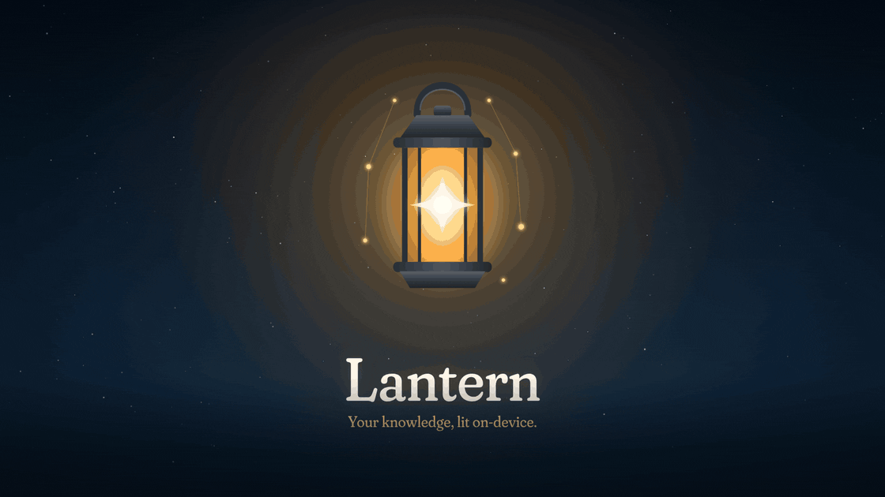
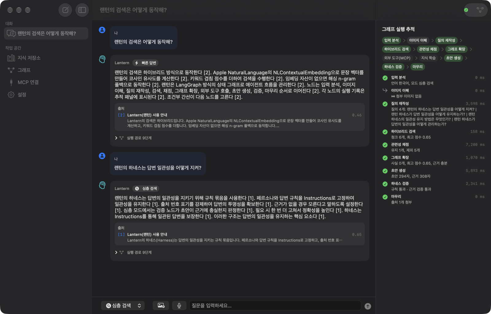
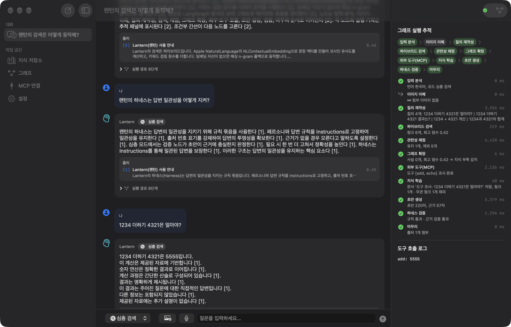
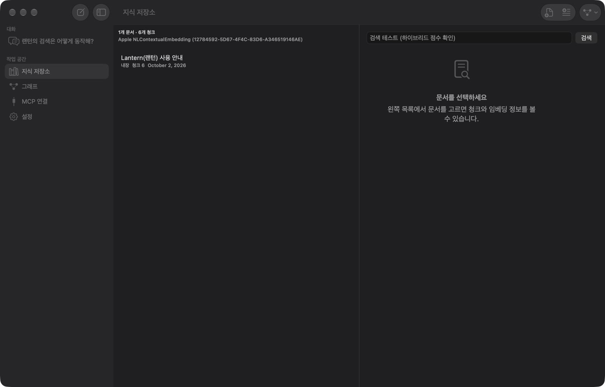
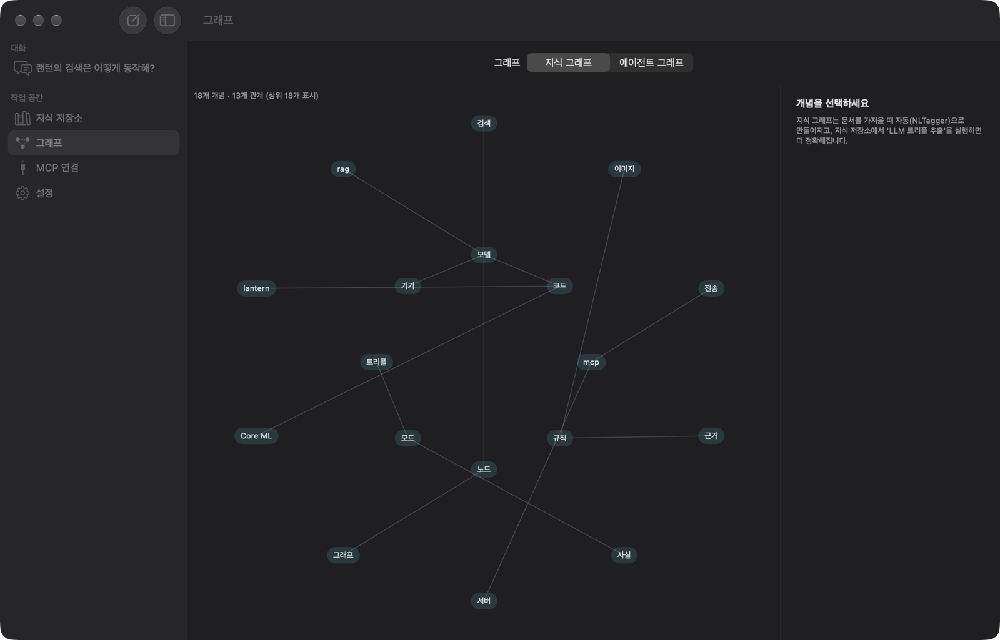
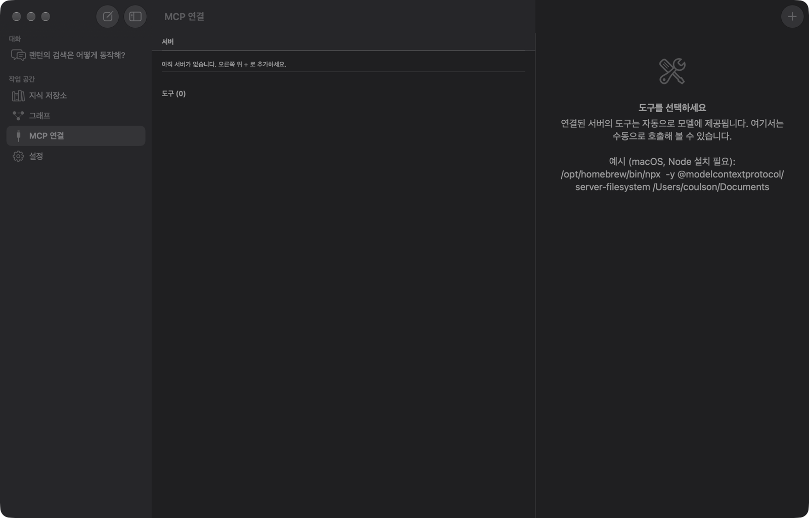
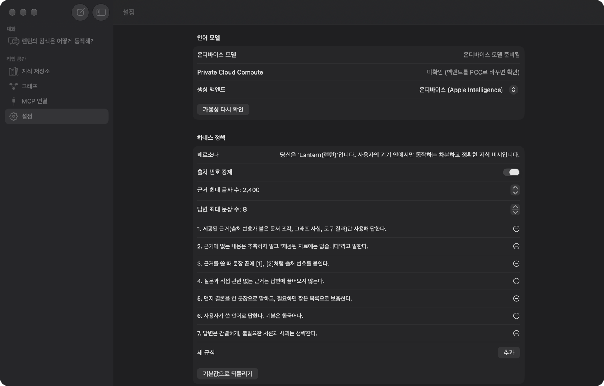
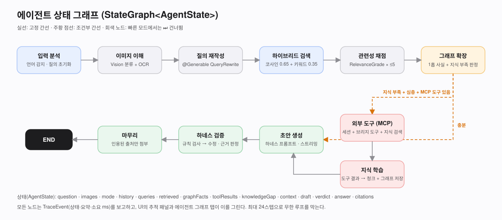

# Lantern — 온디바이스 RAG 에이전트

> **Your knowledge, lit on-device.** — 내 기기 안에 들고 다니는 지식이 묻는 순간 켜지는 SwiftUI 에이전트



<sub>▶ 내레이션과 음악이 있는 1분 53초 영상: <a href="Docs/video/lantern-intro.mp4"><b>Docs/video/lantern-intro.mp4</b></a> · <a href="Docs/video/README.md">만든 방법</a></sub>

랜턴은 Apple Foundation Models(온디바이스 SLM) 위에 **RAG**, **지식 그래프**, **LangGraph 방식 상태 그래프**, **MCP 도구 연결**, **하네스(일관성 규칙)**, **이미지 첨부(멀티모달)**, **음성 입력(STT)** 을 얹은 개인 지식 비서입니다. 문서·대화·임베딩·그래프는 모두 `~/Library/Application Support/Lantern/`의 평문 JSON으로 남고, 기본 설정에서는 네트워크 요청이 한 번도 일어나지 않습니다.



## 한눈에 보기

| 기능 | 어떻게 | Apple 프레임워크 |
|---|---|---|
| 언어 모델 | `SystemLanguageModel.default`, 스트리밍·가이드 생성(@Generable)·도구 호출 | FoundationModels |
| RAG | 문단 청킹 → 문장 임베딩 → 코사인 0.65 + 키워드 0.35 하이브리드 검색 → 근거 블록 `[n]` | NaturalLanguage (NLContextualEmbedding) |
| 지식 그래프 | 주어-술어-목적어 트리플. NLTagger 자동 추출 + LLM 정밀 추출. 질문 주변 1홉 사실을 근거에 추가 | NaturalLanguage |
| 에이전트 그래프 | `StateGraph<AgentState>`: 11개 노드, 조건부 간선, 실행 추적(TraceEvent) | Swift (자체 구현) |
| MCP | JSON-RPC 2.0 클라이언트. stdio(macOS)·Streamable HTTP. 도구 스키마 → `DynamicGenerationSchema` 브리지 | Foundation / FoundationModels |
| 하네스 | 페르소나·규칙을 Instructions로 고정, 출처 강제, 유령 인용 탐지, 자동 수정, 근거 검증 | — |
| 멀티모달 | 이미지를 `Attachment`로 모델에 직접 전달 + Vision 분류·OCR 보조 | FoundationModels, Vision |
| 음성 입력 | `SpeechAnalyzer` + `SpeechTranscriber` 온디바이스 받아쓰기. Hugging Face Whisper 슬롯(탑재 예정) | Speech, AVFoundation |
| 지식 관리 | 지식 부족 감지 → MCP 도구로 조사 → 결과를 문서·그래프로 **학습** → 다음 질문부터 로컬 근거 | — |

## 두 가지 모드

| | 빠른 답변 | 심층 검색 |
|---|---|---|
| 흐름 | 검색 1회 → 생성 → 규칙 검사 | 질의 재작성 → 다중 검색 → 관련성 채점 → 그래프 → (지식 부족 시 MCP 도구 → 학습) → 생성 → 규칙 검사 + 근거 검증 |
| 실측 지연 | 약 8.7초 | 약 15초 (MCP 경로 포함 시 약 15~20초) |
| 모델 호출 수 | 1 | 6~9 |

실측은 M-시리즈 Mac, macOS 27.0.1, 시드 문서 5청크 기준입니다. 자세한 수치는 [Docs/Tasks.md](Docs/Tasks.md)의 검증 로그에 있습니다.

## 화면

| 심층 검색 + 추적 패널 | 지식 부족 → MCP 도구 → 학습 |
|---|---|
|  |  |

| 지식 저장소 | 지식 그래프 |
|---|---|
|  |  |

| MCP 연결 | 설정(하네스 정책) |
|---|---|
|  |  |

## 다이어그램

- [아키텍처 계층](Docs/diagrams/architecture-layers.svg)
- [에이전트 상태 그래프](Docs/diagrams/agent-graph.svg)
- [RAG 파이프라인](Docs/diagrams/rag-pipeline.svg)
- [MCP 도구 호출 시퀀스](Docs/diagrams/mcp-sequence.svg)



## 요구 사항

- Xcode 27, macOS 27 (Apple Silicon) — iOS 27 / visionOS 27 빌드 확인
- Apple Intelligence가 켜진 기기 (온디바이스 모델). 꺼져 있으면 앱이 이유를 표시합니다.
- 선택: MCP 서버 (예: Node 설치 후 `npx -y @modelcontextprotocol/server-everything`)

## 시작하기

1. `Untitled Project.xcodeproj`를 열고 `MyApp` 스킴을 **My Mac**으로 실행합니다.
2. 첫 실행에 내장 안내 문서가 색인되고, Apple 임베딩 자산이 준비되면 자동으로 재색인합니다.
3. **지식 저장소**에서 txt/md/pdf를 가져오거나 텍스트를 붙여넣습니다.
4. 대화창에서 모드를 고르고 질문합니다. 오른쪽 추적 패널에서 각 노드의 결과와 소요 시간을 봅니다.
5. **MCP 연결**에서 서버를 추가하면 도구가 모델에 자동으로 제공됩니다. 심층 모드에서 지식이 부족하면 도구를 호출하고 결과를 학습합니다.

### MCP 서버 추가 예시

| 전송 | 입력 |
|---|---|
| stdio (macOS) | 실행 파일 `/opt/homebrew/bin/npx`, 인자 `-y @modelcontextprotocol/server-filesystem /Users/you/Documents` |
| Streamable HTTP | URL `http://localhost:3000/mcp`, 필요 시 `Authorization` 헤더 |

### 음성 입력

마이크 버튼을 누르면 Apple `SpeechTranscriber`가 현재 로캘의 온디바이스 모델 자산을 내려받아 실시간으로 받아씁니다. 설정에서 **Hugging Face Whisper (Core ML, 탑재 예정)** 를 고르면 모델을 둘 폴더와 추천 저장소를 안내합니다. `SpeechService.swift`의 `HuggingFaceWhisperEngine.start`에 추론 코드를 채우면 됩니다.

## 프로젝트 구조

```
MyApp/
├── MyApp.swift                 앱 진입점
├── ContentView.swift           NavigationSplitView (대화 · 지식 · 그래프 · MCP · 설정)
├── App/
│   ├── AppModel.swift          전체 상태 (@Observable)
│   ├── ChatView.swift          대화 · 입력창 · 추적 패널
│   ├── KnowledgeView.swift     문서 가져오기 · 청크 · 검색 테스트
│   ├── GraphView.swift         지식 그래프 · 에이전트 그래프
│   ├── MCPView.swift           서버 연결 · 도구 호출
│   └── SettingsView.swift      모델 · 하네스 · STT
└── Core/
    ├── Models.swift            데이터 모델 · JSONValue
    ├── StateGraph.swift        LangGraph 방식 그래프 엔진
    ├── LanternAgent.swift      노드 11개 + 조건부 분기
    ├── Harness.swift           정책 · 근거 조립 · 출력 검사
    ├── LanguageModelService.swift  FoundationModels 래퍼 · @Generable 타입
    ├── EmbeddingService.swift  NLContextualEmbedding · 해싱 폴백 · 토크나이저
    ├── VectorStore.swift       하이브리드 검색 · 청커
    ├── KnowledgeGraph.swift    트리플 저장소 · NLTagger 추출
    ├── MCPClient.swift         JSON-RPC · stdio · HTTP
    ├── MCPToolBridge.swift     JSON Schema → DynamicGenerationSchema
    ├── BuiltInTools.swift      지식 검색 · 그래프 · 날짜 · 계산 · 기억
    ├── SpeechService.swift     Apple STT · HF Whisper 슬롯
    ├── ImageUnderstanding.swift Vision 분류 · OCR
    ├── SeedKnowledge.swift     첫 실행 안내 문서
    └── Persistence.swift       JSON 저장소
Docs/
├── TechPRD.md · Tasks.md
├── diagrams/*.svg
├── screenshots/*.png
└── video/                      README 소개 영상(mp4 · gif)과 렌더러
```

## 설계 메모

- **왜 요청마다 새 세션인가** — 온디바이스 모델의 컨텍스트 윈도는 작습니다. 최근 4턴만 200자씩 주입하고, 근거는 글자 예산(기본 2,400자) 안에서 조립해 컨텍스트 초과를 구조적으로 피합니다.
- **왜 하이브리드인가** — `NLContextualEmbedding`은 무관한 문장끼리도 코사인 0.6 안팎이 나옵니다. 키워드 점수를 섞고 문턱 0.45를 두어 "지식 부족"을 가려내고, 심층 모드에서는 모델에게 한 번 더 묻습니다.
- **왜 샌드박스를 껐나** — MCP stdio 서버 프로세스 실행과 HTTP 연결 때문입니다. 배포 시에는 outgoing network 권한을 켜고 stdio를 끄는 샌드박스 구성을 권합니다.
- **PCC** — Private Cloud Compute 백엔드는 `com.apple.developer.private-cloud-compute` 엔타이틀먼트가 있어야 하며, 사용자가 선택했을 때만 가용성을 확인합니다.

## 디버그 실행 인자 (DEBUG)

| 인자 | 동작 |
|---|---|
| `-autoAsk "질문"` | 시작하자마자 질문을 보냅니다 |
| `-deep` | 심층 모드로 시작 |
| `-open knowledge|graph|mcp|settings` | 해당 화면으로 시작 |
| `/tmp/lantern-launch.json` | 같은 내용을 파일로 지정: `{"ask":"…","deep":true,"open":"graph","mcpURL":"http://127.0.0.1:3939/mcp"}` — Xcode 실행처럼 인자를 넘길 수 없을 때 사용. `mcpURL`은 저장하지 않는 임시 MCP 연결 |

## 라이선스

Apache License 2.0 — [LICENSE](LICENSE), [NOTICE](NOTICE)

---

## English summary

**Lantern** is an on-device RAG agent for macOS/iOS/visionOS 27 written entirely in Swift and SwiftUI. It runs Apple's on-device foundation model and adds hybrid retrieval (NLContextualEmbedding cosine + keyword overlap), a knowledge graph of subject–predicate–object triples, a LangGraph-style `StateGraph` with eleven nodes and conditional edges, an MCP client (stdio and Streamable HTTP) whose tool schemas are bridged into Foundation Models tools, a harness that fixes persona and rules and verifies citations, multimodal image attachments, and on-device speech input via `SpeechAnalyzer` with a Hugging Face Whisper slot reserved for later. When local knowledge is insufficient in deep mode, the agent calls MCP tools and stores what it learned as new knowledge. Measured on an Apple Silicon Mac: fast mode about 8.7 s, deep mode about 15 s. Licensed under Apache-2.0.
